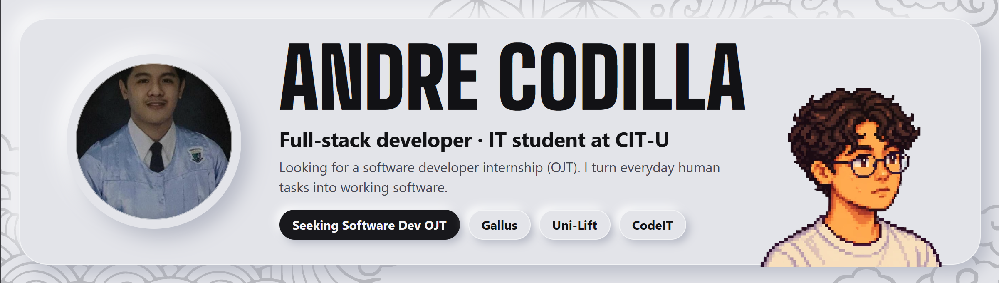
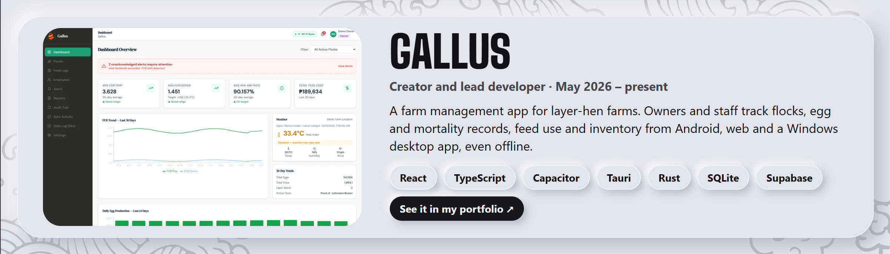
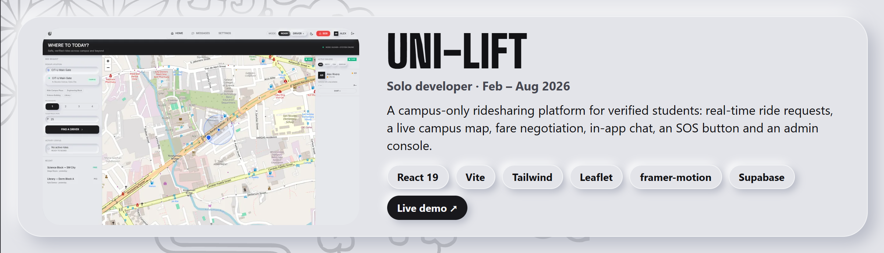
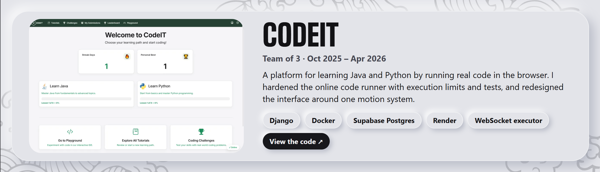
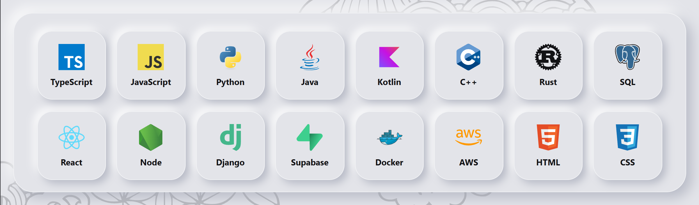

<a href="https://andre-codilla-portfolio.vercel.app">
  <picture>
    <source media="(prefers-color-scheme: dark)" srcset="assets/banner-dark.png">
    
  </picture>
</a>

  <b>Full-stack developer building apps with React, TypeScript and Supabase, now seeking a software developer internship (OJT).</b>

  <a href="https://andre-codilla-portfolio.vercel.app">Portfolio</a> &nbsp;·&nbsp;
  <a href="https://www.credly.com/users/andre-codilla">Credly badges</a> &nbsp;·&nbsp;
  <a href="mailto:andrecodilla03@gmail.com">Email</a>

## About

I am an IT student at Cebu Institute of Technology – University, looking for a software developer internship (OJT). I build full-stack applications with React, TypeScript, Node, Django and Supabase. My projects include Gallus, a farm management app I lead, Uni-Lift, a campus ridesharing web app, and CodeIT, a learn-to-code platform. I break large problems into small steps and work well in a team.

## Featured projects

<a href="https://andre-codilla-portfolio.vercel.app">
  <picture>
    <source media="(prefers-color-scheme: dark)" srcset="assets/gallus-dark.png">
    
  </picture>
</a>

<a href="https://xeldia.github.io/Uni-Lift/">
  <picture>
    <source media="(prefers-color-scheme: dark)" srcset="assets/unilift-dark.png">
    
  </picture>
</a>

<a href="https://github.com/Xeldia/SQAE_CodeIT/tree/CodeIT_Demo">
  <picture>
    <source media="(prefers-color-scheme: dark)" srcset="assets/codeit-dark.png">
    
  </picture>
</a>

Click a card: Gallus opens my portfolio, Uni-Lift opens its live demo, CodeIT opens the code. Uni-Lift's source is at [Xeldia/Uni-Lift](https://github.com/Xeldia/Uni-Lift).

## Tech I work with

<picture>
  <source media="(prefers-color-scheme: dark)" srcset="assets/tech-dark.png">
  
</picture>

## Certifications and badges

- **IBM SkillsBuild** · Cybersecurity Fundamentals, Artificial Intelligence Fundamentals
- **AWS Academy Graduate** (training badges) · Cloud Foundations, Generative AI Foundations, Cloud Architecting

All verified on [Credly](https://www.credly.com/users/andre-codilla).

## Let's talk

<a href="https://andre-codilla-portfolio.vercel.app">
  <picture>
    <source media="(prefers-color-scheme: dark)" srcset="assets/contact-dark.png">
    
  </picture>
</a>
